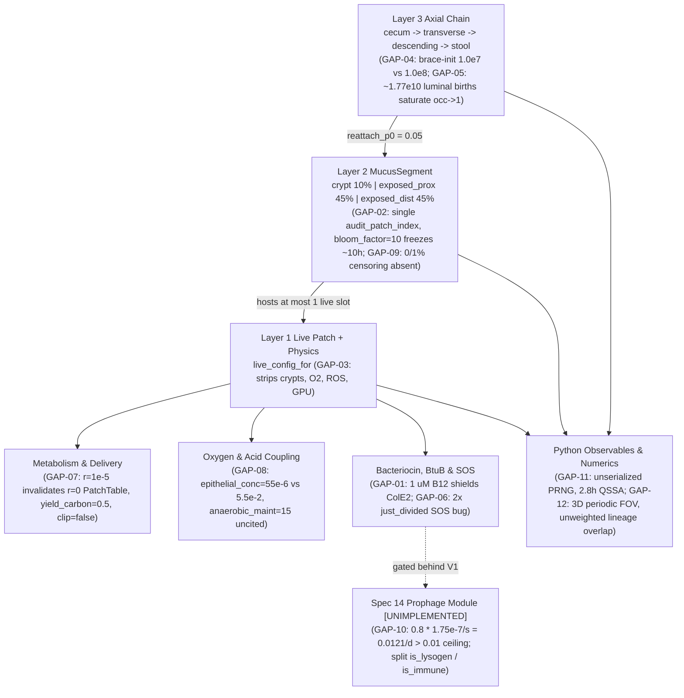

# GutIBM Spec 13–14 Code-vs-Specification & Parameter Provenance Audit

**Repository Audited:** `bckirkup/GutModelBacteriocins` (`main`)  
**Companion Documents & Data Tables:**
- [CYCLE2_EMPIRICAL_CALIBRATION_REVIEW.md](CYCLE2_EMPIRICAL_CALIBRATION_REVIEW.md) — Consensus API literature benchmarks & unit conversions
- [parameter_provenance_audit.csv](parameter_provenance_audit.csv) (23 parameter entries)
- [open_gaps_and_validation_matrix.csv](open_gaps_and_validation_matrix.csv) (12 gaps, `GAP-01..GAP-12`)
- [consensus_empirical_benchmarks.csv](consensus_empirical_benchmarks.csv) (41 empirical benchmarks)
**Target Venues:** ASM *mSystems* / *mBio*

---

## 1. Executive Verdict

GutIBM's Layer 1–3 physics engine and conservation accounting are structurally sound on single-patch, Layer-2 metapopulation, and Layer-3 axial-chain runs—closing all conservation ledgers (`36/36` Spec 13 placement runs and `6/6` Spec 13 gradient runs with `ledger.closed = true`) and achieving `40/40` phase-by-phase CPU/live-patch parity (`0` lineage alive-count mismatches). However, **four critical blockers (`GAP-01..GAP-04`) and five high-severity discrepancies (`GAP-05..GAP-09`) block immediate Cycle 2 publication campaigns**:

1. **Spec 14 V1 *In Vitro* Exclusion Failure (`GAP-01`, `CRITICAL_BLOCKER`):** Under shipped `b12_initial_conc = 1.0e-3 mol/m^3` (~1 uM), BtuB corrinoid saturation shifts apparent `kd_colicinE_btuB` 1,000-fold (`5.0e-7 -> 5.01e-4 mol/m^3`), collapsing ColE2 efficacy to `0.121` kills/lysis and `-0.036 decades/h`. Across a 6-order corrinoid sweep (`1e-3..1e-9 mol/m^3`), **every arm fails** the Spec 14 V1 target (`+0.33 decades/h` = 100x exclusion in 6 h); the best arm (`1e-5 mol/m^3`, `7.38` kills/lysis) reaches only `+0.090 decades/h` (`~22 h` extrapolated) and hits the dysbiosis guard four times over (`23,185` agents).
2. **Spec 13 Layer 2–3 Single-Live-Patch Architecture Limit (`GAP-02`, `GAP-03`, `CRITICAL_BLOCKER`):** `layer2.audit.patch_index` permits at most one live patch in Layer 2 and zero in Layer 3 (`ConfigError` in `src/layer3/chain.cpp:99-103`), producing `reseeds = 0` across all `10/10` incubator placement runs while `bloom_factor = 10.0` halts live patches around ~300 cells (`~30 min`–`10 h`). Worse, `MucusSegment::live_config_for` (`src/layer2/segment.cpp:533-539`) forces `advection.crypts_enabled = false`, `oxygen.enabled = false`, `k_ROS_* = 0.0`, and `gpu.enabled = false`, stripping crypt flow refugia from live patches.
3. **Un-synchronized `Layer3Config` `flora_density_cfu_ml` `1.0e7` Bug (`GAP-04`, `CRITICAL_CODE_BUG`):** While `Layer3RegionConfig` struct defaults `flora_density_cfu_ml = 1.0e8` (`src/layer3/layer3_config.h:49`), the `Layer3Config` brace-initializers for `cecum`, `transverse`, and `descending` (`src/layer3/layer3_config.h:61-63`) **still hardcode `1.0e7`**. Furthermore, `analysis/spec13_gradient/run_readout.py:222` was edited to `1.0e8` without regenerating `readout_summary.json` and `verdicts.csv`, leaving committed fractions at `13.72%–40.58%` instead of the reconciled `1.38%–4.06%`.
4. **Lumen-to-Mucosa Saturation & Kinetics/Stoichiometry Drift (`GAP-05..GAP-08`, `HIGH`):** Layer-3 luminal births (`~1.77e10`) overwhelm mucosal births (`4.06e5–5.05e5`) by `~4e4x`, driving occupancy to `0.994–0.999` (`72 h`) under `reattach_p0 = 0.05`. Meanwhile, `FixMetabolism` + `FixBacteriocin` execute a **2x SOS lysis hazard bug** (`just_divided = true` on both mother and daughter), `delivery_far_field_radius = 1.0e-5 m` invalidates `#314`'s `r = 0` `PatchTable`, `yield_carbon = 0.5 mol/kg` is `~6.4x` cheaper than standard *E. coli* stoichiometry (`~3.2 mol/kg`), and `oxygen.epithelial_conc = 55.0e-6 mol/m^3` sits `1,000x` below physiological 42 mmHg (`5.5e-2 mol/m^3`).

---

## 2. Reconciled Stale Documentation vs. Current `main` Source

Several specification documents predate PRs merged into `main`. Auditing C++ headers directly resolves five stale claims:

| Item | Stale Specification Statement | Verified Current `main` State | Source Reference |
|---|---|---|---|
| Layer 2 & 3 status | "Nothing in this spec is implemented" (`docs/SPEC13_MULTISCALE.md:33`) | **Implemented and closed:** `MucusSegment`, `PatchTable`, `Layer3Config`/`Chain`, checkpoints, and readouts exist and run end-to-end | `src/layer2/segment.cpp`, `src/layer3/chain.cpp` |
| Microcin secretion | Missing/drafted in early design notes | **Implemented:** `BacteriocinConfig::microcin_mu_penalty = 0.03` | `src/fixes/fix_bacteriocin.h:38` |
| Mucin electrostatic charge | Unimplemented or static scalar | **Implemented:** `MucinChargeConfig` with pI-driven `plasmid_overrides` (`ColE1` ret `50.2`, `ColE2` ret `2.04`) | `src/fixes/fix_bacteriocin.h:43`, `src/genome/plasmid.cpp` |
| Concentration units | Mixed mM / uM drafts in early Spec 12 | **Consistent SI molar:** grids and `Km`/`Kd`/`epithelial_conc` parsed in `mol/m^3` (`1 mM = 1 mol/m^3`, `1 uM = 1e-3 mol/m^3`) | `src/io/chem_environment_config.h`, `docs/SPEC12_DENSITY_LIMITATION.md:50` |
| Live-patch shadow parity | Uncertain live vs shadow alignment | **Verified parity on 10-step gate:** `40/40` phases identical (`positions, state, mu, C, Fe`), `0` alive-count mismatches, `39.5 ms/step` live vs `75 ms/step` standalone (`19.7 MB` RSS delta) | `analysis/spec13_live_patch/readout_summary.json` |
| Spec 12 key names | Spec text cites `oxygen.aerobic_yield_factor`, `oxygen.acid_inhibition_enabled`, `Ki_acetate` | **Parser rejects those 5 keys:** real keys use substrate-cost reciprocity (`oxygen.aerobic_carbon_cost_factor = 1.0`, `anaerobic_carbon_cost_factor = 4.1`, `metabolism.acid_inhibition_enabled`, `acid_inhibition_Ki = 50.0` undissociated) | `docs/SPEC12_DENSITY_LIMITATION.md:44-59,76-80` |

---

## 3. Verified Spec 13 Simulation Readouts

### 3.1 Phase 1 — Layer 2 Occupancy (`analysis/spec13_occupancy/`)

- **Stage-A Sweep (`results.csv`, `4,374` full-factorial arms):** `790` (`18.06%`) satisfy both stationary targets (`occ_total` in `0.00104–0.00994`, median `0.00524`; `segment_mean_cfu_ml` in `10,032–98,938`, median `36,467`), `2,535` fall below `0.1%` occupancy, `538` meet occupancy band but fall below `1e4 CFU/mL`, `424` terminate via `population_stop` extinction, `82` exceed `1%` occupancy, and `5` exceed `1e5 CFU/mL`.
- **Stage-B Replicate Audit Reconciliation (`results_seeds.csv`, `3,950` runs across the `790` Stage-A arms, `3,052` admissible):** Direct row grouping reveals an exact **off-by-one labeling note in `analysis/spec13_occupancy/REPORT.md:15`**:
  - `377/790` arms pass `5/5` Stage-B seeds (`6/6` total including Stage A).
  - `201/790` arms pass `4/5` Stage-B seeds (`5/6` total).
  - **`578/790` (`377 + 201`) is `>=4/5` Stage-B (`>=5/6` total)**, whereas `REPORT.md` describes `578` as `>=4/6` total (`>=3/5` Stage-B + Stage A actually equals **`647/790`**; `>=1/5` Stage-B = `745/790`; `0/5` Stage-B = `45/790`).
- **Source–Sink Mechanism:** Admissibility is carried entirely by crypt patches (`occ_crypt` `0.0104–0.0982`, median `0.0500`), while `occ_proximal` (median `0`, max `0.00717`) and `occ_distal` (median `0`, max `0.00420`) churn near zero. Admissible count drops sharply with peristalsis (`contraction_rate_per_min`: `0.2 -> 606`, `0.6 -> 144`, `1.0 -> 40`).

### 3.2 Phase 2 — Live-Patch Placement (`analysis/spec13_placement/`)

- **Churn (`15/15` runs):** Total extinction occurs in `<=3 h` (crypt) or `<0.5 h` (proximal); `deaths = 0`, `reseeds = 0–1` (`REPORT.md:41-49`).
- **Persistent (`1` seed):** With churn disabled under shipped advection, all `10` C founders wash out `<2 h` and R washes out `~4 h`, leaving S purely by initial spatial placement (`434` exports, `deaths = 0`).
- **Incubator (`10` disk `incub_*_ts.csv` traces verified alongside `REPORT.md:58-98`'s 20-run matrix):** Every run survives (`patch_cells_end` `520–1,053`), `reseeds = 0` in all runs (single live patch cannot reseed another live patch), and the `ship` retardation arm (`ret = 50.2`) generates up to **21x more deaths** than `lit` (`ret = 1.2`) on matched seeds (`281` vs `15` on `s20261031`; `44` vs `10` on `s20261029`; `42` vs `13` on `s20261027`; `0` in all `lysis = 0` nulls and in extinct seeds `s20261028`/`s20261030`). However, `bloom_factor = 10.0` trips around `300` cells (`~30 min`), freezing composition at `~10–12 h` (`n_live = 488` vs `n_shadow = 57` at `12 h`, relative diff `7.56`), and the final census row doubles the frozen count (`492 -> 984`). Note also that `deaths` does not decompose self-lysis deaths from toxin-mediated receptor kills.

### 3.3 Phase 3 — Layer 3 Colonic Gradient (`analysis/spec13_gradient/`)

| Metric (Tail Window `47h50–71h50`, Seeds `1001–1003`) | Target | Gradient Arm (Stale `1e7`) | Gradient Arm (Reconciled `1e8`) | Uniform Arm | Audit Verdict |
|---|---|---|---|---|---|
| Stool output (`CFU/g`) | `1e6–1e8` | `8.28e6` | `8.28e6` | `8.12e6` | **Met** (ledger closed `6/6`) |
| Cecum mucosal fraction | `0.68%–3.81%` (Hong) | `13.47%–13.77%` | `1.38%` (`1.3759e6` `CFU/mL`) | `17.23%–19.74%` (`1e7`) | **C++ init stale (`GAP-04`)** |
| Transverse mucosal fraction | `0.68%–3.81%` (Hong) | `19.34%–20.70%` | `1.94%` (`1.9351e6` `CFU/mL`) | `16.72%–21.50%` (`1e7`) | **C++ init stale (`GAP-04`)** |
| Descending mucosal fraction | `0.68%–3.81%` (Hong) | `27.83%–40.58%` | `4.06%` (`4.0596e6` `CFU/mL`) | `15.60%–17.71%` (`1e7`) | **C++ init stale (`GAP-04`)** |
| Regional flatness (`max/min`) | `<= 4.0` | `2.07–2.96` | `2.07–2.96` | `1.15–1.38` | **Met** (invariant to denominator) |
| Patch occupancy (`72 h`) | `0.1%–1.0%` (Phase 1) | `99.36%–99.85%` | `99.36%–99.85%` | `99.71%–99.86%` | **Saturated (`GAP-05`)** |

**Exact Bug Proof (`GAP-04`):** `gradient_seed1001_prov.json` omits `flora_density_cfu_ml` from `config_snapshot.layer3`, while `src/layer3/layer3_config.h:61-63` initializes `cecum`, `transverse`, and `descending` with `1.0e7` despite the struct default `1.0e8` on line `49`. Re-analyzing `gradient_seed1001_timeseries.csv` (`t >= 172800 s`, `n = 144`) yields `mean_cfu_ml = 1.3759e6 / 1.9351e6 / 4.0596e6`, matching `readout_summary.json` (`0.1372 / 0.1939 / 0.4058`) **only when divided by `1e7`**—proving `readout_summary.json` and `verdicts.csv` were never regenerated after `run_readout.py:222` was changed to `1e8`.

---

## 4. Spec 14, Spec 12 & Spec 2 Mechanism Audits

### 4.1 Spec 14 §8 V1 Failure & Prophage Prior Violations (`GAP-01`, `GAP-10`)

Under `FixReceptor::toxin_occupancy`, `apparent_kd = kd_colicinE_btuB * (1 + [corrinoid] / kd_b12_btuB)` (`docs/SPEC14_SECTION8_VALIDATION.md:66`). Because B12 simultaneously fuels growth (`km_b12 = 1e-6 mol/m^3`) and competitively blocks BtuB (`kd_b12_btuB = 1e-6`), reducing corrinoid creates a narrow squeeze where V1 fails everywhere:

| `b12_initial_conc` (`mol/m^3`) | Apparent Kd (`mol/m^3`) | Selection (`decades/h`) | Kills / Producer Lysis | Kills / Division | Final Agents (Termination) |
|---|---|---|---|---|---|
| `1e-3` **(shipped)** | `5.01e-4` | `-0.036` | `0.121` | `0.0013` | `28,888` (`guard`) |
| `1e-4` | `5.05e-5` | `-0.052` | `1.17` | `0.0112` | `17,873` (`guard`) |
| `1e-5` | `5.50e-6` | `+0.090` | `7.38` | `0.092` | `23,185` (`guard`) |
| `1e-6` | `1.00e-6` | `+0.081` | `6.29` | `0.091` | `1,651` (`horizon`) |
| `1e-9` | `5.00e-7` | `+0.000` | `1.5` | `—` | `120` (`horizon`) |

**Key Structural Findings:**
- Even at `1.17` kills/lysis (`1e-4 mol/m^3`), producer selection is negative (`-0.052 decades/h`) because dead sensitives vacate carbon/space that remaining neighbors rapidly re-fill; break-even lies between `1.17` and `7.38` kills/lysis (`SPEC14_SECTION8_VALIDATION.md:90-97`).
- **No Spec 14 prophage C++ code is merged**, and its implementation remains **blocked behind V1 (`GAP-01`)**. When unlocked, `SPEC14_PRIOR_REVIEW.md` identifies two mandatory design corrections (`GAP-10`): (i) `lysogen_prevalence_init * spontaneous_induction_rate` at `0.8 * 1.75e-7/s = 0.0121/bact/day` (`0.0151` at `1.0`) exceeds the community-average gut induction ceiling (`0.001–0.01/bact/day` from *Current Biology* 2025, `10.1016/j.cub.2025.03.073`); and (ii) sequence-detected cryptic prophages confer immunity without inducibility, requiring separate `is_lysogen` and `is_immune` boolean flags. Furthermore, `De Paepe 2016` (`0.016 h^-1` ODE fit [95% CI `6.3e-3 to 3.6e-2`], `0.0170 +/- 0.0046` per generation in vivo mouse induction) and `Henrot 2026` share a senior author (`Petit`), so prevalence and community lysis ceilings provide the primary independent anchor.

### 4.2 Spec 2 & Spec 12 Parameter and Kinetics Defects (`GAP-06`, `GAP-07`, `GAP-08`, `GAP-11`)

- **2x SOS Lysis Bug (`GAP-06`):** `src/core/simulation.cpp:1761-1763` resets `just_divided = false` before biology, `src/fixes/fix_metabolism.cpp:902-903` sets `just_divided = true` on **both** `a` (mother) and `daughter`, and `src/fixes/fix_bacteriocin.cpp:88-89` applies `sos_lysis_prob / bio_dt` to every flagged cell—doubling effective spontaneous SOS death from `1.0%` to `~1.99%` per division.
- **Invalidated Carbon Ladder & Stoichiometry (`GAP-07`):** `src/layer2/patch_table.h:36-42` hardcodes `#314` capacities (`100..9,046` cells at `0.25x..4.0x`) measured with single-voxel `delivery_far_field_radius = 0.0`, whereas `src/fixes/fix_metabolism.h:74` now ships `delivery_far_field_radius = 1.0e-5 m` (`10 um`, which also throws `ConfigError` under `chemistry_decomposition = "slab"`, `input_parser.cpp:622-631`). Meanwhile, `uptake_limit = "none"`, `enforce_reaction_clip = false`, and `yield_carbon = 0.5 mol/kg` (`~6.4x` lower than `~3.2 mol C-equiv/kg` aerobic stoichiometry) remain uncalibrated defaults, and CUDA Route B delivery (`CUDA_DELIVERY_PARITY.md:70-75`) supports only `replicated`, `nprocs == 1`, line length `<= 512`.
- **Oxygen & Maintenance Scale (`GAP-08`):** `src/io/chem_environment_config.h:25,27,43` ships `epithelial_conc = 55.0e-6 mol/m^3` (`~0.042 mmHg`, `1,000x` below physiological `42 mmHg ≈ 5.5e-2 mol/m^3` noted in the header comment itself), `anaerobic_maintenance_factor = 15.0` without citation, and `respiration_driver = "funded"` restricted to CPU-only.
- **Numerics (`GAP-11`):** PRNG states are not fully serialized across restarts (`simulation.cpp:529-530`), and QSSA assumes quasi-steady toxin fields despite `~2.8 h` diffusion-retardation relaxation under `ColE1` (`ret = 50.2`) across `dt = 60 s`.

---

## 5. Condensed Parameter Provenance Summary

Full inventory resides in [parameter_provenance_audit.csv](parameter_provenance_audit.csv).

| Parameter Key | Shipped C++ Default | Empirical / Reconciled Value | Host Scope | Audit Status |
|---|---|---|---|---|
| `layer3.*.flora_density_cfu_ml` | `1.0e8` struct; `1.0e7` init | `1.0e8–2.0e8 cells/mL` (Swidsinski FISH) | Human colon | `CRITICAL_CODE_DOC_MISMATCH` |
| `b12.initial_conc` | `1.0e-3 mol/m^3` | `~1 uM` total vs unknown free fraction | Colon vs in vitro | `CRITICAL_VALIDATION_BLOCKER` |
| `layer2.audit.patch_index` | `-1` (max 1 Int) | `>= 10` live patches needed | Multiscale | `CRITICAL_SPEC13_BLOCKER` |
| `layer2.live_config_for` | Forces `crypts=false`, `O2=false` | Preserve per-type advection & opt-in O2 | Crypt vs exposed | `CRITICAL_PHYSICS_BLOCKER` |
| `layer2.bloom_factor` | `10.0` (~300 cells) | Live carrying capacity `~500–9,046` cells | Multiscale | `PREMATURE_FREEZE_GUARD` |
| `layer3.reattach_p0` | `0.05 /transit` | Uncalibrated; drives `occ -> 0.998` | Human colon | `HIGH_SATURATION_FEEDBACK` |
| `bacteriocin.sos_lysis_prob` | `0.01` (`~1.99%` realized) | `~0.1%–1.0%` per division | General *E. coli* | `ACTIVE_2X_HAZARD_BUG` |
| `metabolism.delivery_far_field_radius` | `1.0e-5 m` | `#314` PatchTable measured at `0.0 m` | Numerical/Layer 2 | `INVALIDATED_CALIBRATION_TABLE` |
| `metabolism.yield_carbon` | `0.5 mol/kg` | `~3.2 mol/kg` (Varma & Palsson) | General *E. coli* | `STOICHIOMETRY_MISMATCH_6X` |
| `chem_env.oxygen.epithelial_conc` | `55.0e-6 mol/m^3` | `5.5e-2 mol/m^3` (`42 mmHg`) | Colonic mucosa | `UNIT_SCALE_MISMATCH_1000X` |
| `chem_env.oxygen.anaerobic_maintenance_factor` | `15.0` | Uncited multiplier | General *E. coli* | `UNGROUNDED_PARAMETER` |
| `plasmid_overrides.ColE1.retardation` | `50.2` (`pI ~9.0`) | `1.2–50` uncertainty (`21x` death swing) | Mucus gel | `HIGH_LEVERAGE_UNCERTAIN` |
| `spec14.spontaneous_induction_rate` | Unimplemented (`1.75e-7 /s`) | `0.8 * 1.75e-7/s = 0.0121/d` (`>0.01` ceiling) | Mouse vs human | `PRIOR_CEILING_VIOLATION` |
| `spec14.lysogen_prevalence_init` | Unimplemented (`0.8`) | Split inducible (`is_lysogen`) vs `is_immune` | Human MAGs | `CRYPTIC_VS_INDUCIBLE_CONFOUND` |

---

## 6. Cycle 2 External Development & Compute Roadmap

Recommended Cycle 2 PR sequence targeting local CPU CI and **RTX 3070Ti / AWS Batch**:

| Work Package | Target Repository Scope | Compute / Execution Target | Exit Gate |
|---|---|---|---|
| **PR-1 (`GAP-04`, `GAP-06`)** | Fix `Layer3Config` `1e7 -> 1e8` (`L61-63`), log `flora_density_cfu_ml` in `prov.json`, regenerate `verdicts.csv`; fix 2x `just_divided` bug in `fix_metabolism.cpp:902-903` | Local CPU CI (`ctest`) + `--analyze-only` | Mucosal fraction `1.4%–4.1%`; SOS lysis/division equals `sos_lysis_prob` (`1.0%`) |
| **PR-2 (`GAP-01`)** | Decouple free vs bound corrinoid (`free_b12_fraction` or non-BtuB colicin controls `ColE1`/`ColIa`/`ColB`) and run `Spec 14 §8 V1` diagnostic ladder | **RTX 3070Ti** (CUDA serial batch `<= 512` line) | V1 reaches `>= 0.33 decades/h` (`100x` exclusion in `6 h`) without dysbiosis guard false trip |
| **PR-3 (`GAP-02`, `GAP-03`, `GAP-05`)** | Extend `audit.patch_index -> audit_patch_indices` (`>= 10` live patches, Layer 3 opt-in), preserve `crypts_enabled` in `live_config_for`, split `deaths` into `sos_lysis` + `toxin_kill`, calibrate `reattach_p0` & `bloom_factor` | **AWS Batch** CPU/MPI ensemble (`3^k` sweep + paired seeds) | Non-zero `pool->live` reseeds, sustained C/S/R coexistence window, unsaturated patchy occupancy |
| **PR-4 (`GAP-07`, `GAP-08`, `GAP-11`)** | Re-tabulate `#314` `PatchTable` at `delivery_far_field_radius = 1e-5`, test `enforce_reaction_clip = true`, sweep `agent_carbon_coupling` `{0, 1e-21, 1e-20, 1e-19}` & physiological `pO2`, serialize PRNG checkpoints | **AWS Batch** + **RTX 3070Ti** Route B parity gate | Host == CUDA funded carbon & population within seed tolerance; exact checkpoint bit-parity |
| **PR-5 (`GAP-10`) [GATED]** | Implement Spec 14 prophage induction **only after PR-2 passes V1**, with separate `is_lysogen` / `is_immune` flags and total community induction `0.001–0.01/bact/day` | **AWS Batch** V2 10-day dixenic competition | Simultaneous V1 exclusion + V2 coexistence without exceeding community induction ceiling |

## References

[8] [**Carriage of λ Latent Virus Is Costly for Its Bacterial Host due to Frequent Reactivation in Monoxenic Mouse Intestine**](https://doi.org/10.1371/journal.pgen.1005861) — Marianne De Paepe, Laurent Tournier, Elisabeth Moncaut, Olivier Son, Philippe Langella, Marie‐Agnès Petit (2016). 10.1371/journal.pgen.1005861
