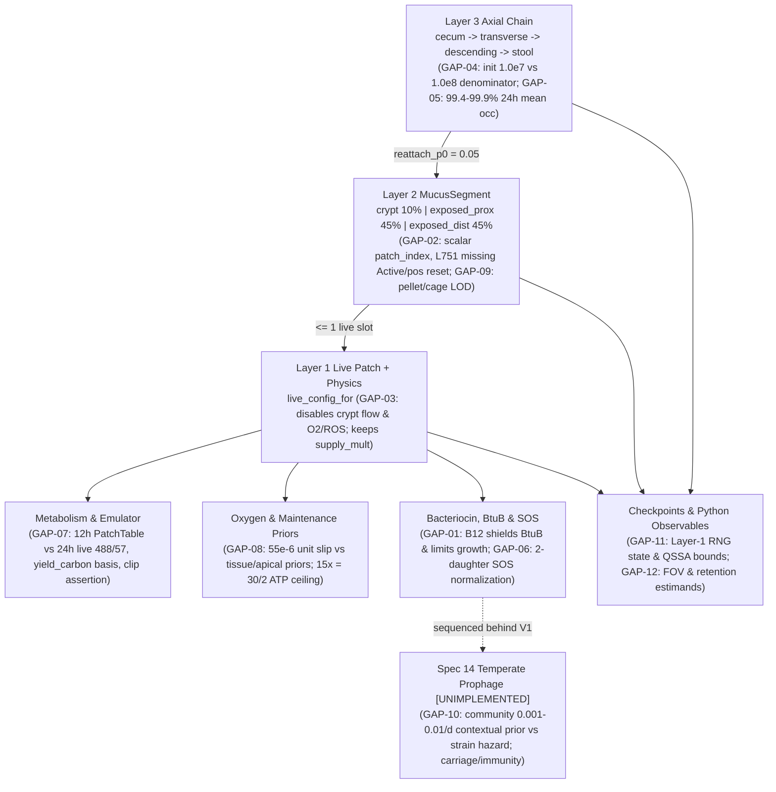

# GutIBM Spec 13–14 Code-vs-Specification & Parameter Provenance Audit

**Status:** Reconciled against `main` (`72cd2842d9`) and 142-claim independent audit  
**Repository Audited:** `bckirkup/GutModelBacteriocins`  
**Companion Documents & Data Tables:**
- [CYCLE2_EMPIRICAL_CALIBRATION_REVIEW.md](CYCLE2_EMPIRICAL_CALIBRATION_REVIEW.md) — Reconciled empirical literature synthesis & observable-to-parameter mapping rules
- [consensus_doi_index.csv](consensus_doi_index.csv) (210-DOI item-level retrieval index)
- [parameter_provenance_audit.csv](parameter_provenance_audit.csv) (23 parameter provenance entries)
- [open_gaps_and_validation_matrix.csv](open_gaps_and_validation_matrix.csv) (12 reconciled gaps, `GAP-01..GAP-12`)
- [consensus_empirical_benchmarks.csv](consensus_empirical_benchmarks.csv) (41 primary-verified benchmarks)
**Target Venues:** ASM *mSystems* / *mBio*

> **Status (2026-11-22):** This audit records the `72cd284` baseline. Engineering remediations for `GAP-01` through `GAP-12` have since landed on `main` via PRs #484–#495—including default-off `FixProphage` (`GAP-10`, PR #494), the hybrid CPU/GPU wall-normal Peclet solver (#478, PR #495), and the `ChemicalField` multi-rank OOM guard + device-resident GPU stepping (#480, PR #493; see [`open_gaps_and_validation_matrix.csv`](open_gaps_and_validation_matrix.csv) for per-gap resolution status). Empirical §8 V1 and *in vivo* lysogen-displacement campaigns remain open scientific evaluations.

---

## 1. Executive Verdict

Across committed single-patch, Layer-2 segment, and Layer-3 three-region runs, GutIBM's conservation accounting and 10-step live/shadow parity checks pass within their tested scope (`36/36` Spec 13 placement runs and `6/6` Spec 13 gradient runs report `ledger_closed = true`; `40/40` phase comparisons match in `analysis/spec13_live_patch/readout_summary.json`, with recorded local step times `39.5 ms/step` live vs `75 ms/step` standalone and `19.7 MB` RSS delta). Those narrow computational invariants confirm bookkeeping closure on tested configurations, **not** end-to-end biological completion of Spec 13 or Spec 14.

Reconciling the codebase at `72cd2842d9` against primary literature and committed campaign artifacts separates **true code/readout defects** from **conditional scientific hypotheses**:

1. **Spec 14 §8 V1 Failure & Confounded Corrinoid Competition (`GAP-01`, `CRITICAL_BLOCKER`):** At shipped `b12_initial_conc = 1.0e-3 mol/m^3` (`src/io/input_parser.h:113`), unit-multiplier competitive binding gives factor `1 + 1e-3 / 1e-6 = 1001` and `apparent_Kd = 5.005e-4 mol/m^3` (`0.5005 uM`; ligand-only `BtuB` occupancy `1000/1001`). In the prior documented V1 campaign (`docs/SPEC14_SECTION8_VALIDATION.md`, run at `5fb4250`, raw HDF5 uncommitted), **every tested corrinoid level (`1e-3..1e-9 mol/m^3`) fell short** of the `+0.33 decades/h` 6-h exclusion target (best arm `1e-5`: `+0.090 decades/h`, `7.38` kills/lysis, halted at `23,185` agents by the dysbiosis guard). Lowering a single `[B12]` scalar is not a clean potency fix because it simultaneously restricts corrinoid-dependent growth (`km_b12 = 1e-6`) and alters `MetE` receptor-loss costs, while the plasmid-free null measures net producer strategy (including plasmid carriage cost) rather than toxin-only action. Note also that `ColE1` shares `ReceptorType::BtuB` (`src/genome/plasmid.cpp:41`) and is **not** a non-BtuB control (`ColIa` uses `CirA` and `ColB` uses `FepA`, with phage-lysis release and iron competition).
2. **Spec 13 Live-Slot Architecture, Reattachment Guards, & Analyzer Fixes (`GAP-02`, `GAP-03`):** `Layer2AuditConfig::patch_index` (`src/layer2/layer2_config.h:46`) permits at most one live patch in Layer 2 and zero in Layer 3 (`src/layer3/chain.cpp:99-103`), leaving patch-to-patch live reseeding unobservable (`reseeds = 0` across all `20` incubator runs). While `src/layer2/segment.cpp:751-760` *already* contains a `dest.live` insertion branch, it omits `dest.status == PatchStatus::Active` (permitting insertion into halted live patches) and leaves `cell.pos` at origin-patch coordinates. In `live_config_for` (`segment.cpp:533-539`), within-patch crypt flow refugia (`crypts_enabled = false`), oxygen/ROS, and GPU are disabled while patch-type `supply_mult` carbon scaling and disruption probabilities remain active. Finally, in `analysis/spec13_placement/analyze.py`, duplicate terminal `t_max` rows in `lineage.csv` doubled reported `final_alive` (`14/492/1 -> 28/984/2` on `s20261027`) and `max` replaced per-lineage `sum` on `emigrants_cum` (`28/45/9 = 82` true washout vs `12/36/1`); **both analyzer bugs are corrected in this PR**, alongside updating the joint `ship` (`D = 4e-11, ret = 50.2`) vs `lit` (`D = 7e-11, ret = 1.2`) total biological death contrast from `21x` to **`18.7x` (`281 / 15 = 18.73`)**.
3. **Layer-3 `flora_density_cfu_ml` `1.0e7` vs. `1.0e8` Denominator Mismatch (`GAP-04`, `CRITICAL_CODE_BUG`):** `Layer3RegionConfig` defaults `flora_density_cfu_ml = 1.0e8` (`src/layer3/layer3_config.h:49`), whereas the `Layer3Config` aggregate initializers for `cecum`, `transverse`, and `descending` (`L61-63`) pass `1.0e7` (which *is* recorded in `analysis/spec13_gradient/out/*_prov.json` under `layer3.regions[*]`). Because `flora_density_cfu_ml` acts purely as an output normalization denominator, reconciling it to `1.0e8` rescales final-24h mucosal fractions 10-fold across **both** arms (`gradient`: `1.35%–1.38%`, `1.93%–2.07%`, `2.78%–4.06%`; `uniform`: `1.72%–1.97%`, `1.67%–2.15%`, `1.56%–1.77%`) without requiring dynamic C++ reruns.
4. **Refined Code & Stoichiometry Dispositions (`GAP-05..GAP-12`):**
   - **`PatchTable` provenance (`GAP-07`):** `docs/CARBON_LADDER_CAMPAIGN.md:155-188` (`a115447`) confirms `{100, 100, 122, 1063, 9046}` was **already** measured with `uptake_limit = delivery` over the `10 um` support (withdrawing the earlier `r = 0` invalidation claim); the real emulator discrepancy is finite-12h single-strain regime mismatch (`n_live = 488` vs `n_shadow = 57` in 24-h placement runs), while `enforce_reaction_clip` (`simulation.cpp:1422-1468`) is a fail-on-clipping assertion gate rather than a positivity switch, and `chemistry_decomposition = "slab"` (not founder `z_slab` placement) triggers the `10 um` `ConfigError` (`input_parser.cpp:622-631`).
   - **Post-division SOS normalization (`GAP-06`):** Flagging both mother and daughter (`fix_metabolism.cpp:902-903`) gives per-cell induction `1 - exp(-0.01) = 0.9950%` over `bio_dt` (when other hazards are zero), or `0.01990` expected inductions per mother division (`1.9801%` chance of `>=1` daughter induced) followed by delayed lysis—requiring an explicit choice of per-mother vs per-daughter normalization.
   - **Oxygen, Maintenance, & Yield (`GAP-07`, `GAP-08`):** `PARAMETERS.md:528-561` already documents the `30/2 ATP/Glc = 15.0` maintenance rationale and the `~3.2 mol glucose/kg wet mass` (`30%` dry fraction, Varma & Palsson 1993 `0.524 gDW/g`) comparison for `yield_carbon = 0.5`; `funded` respiration runs on the host without throwing on `gpu.enabled` (`input_parser.cpp:632-648`).
   - **Layer-scoped checkpoints & Python observables (`GAP-11`, `GAP-12`):** Layer 2 and Layer 3 already serialize their patch/packet/contraction RNG states (`segment_io.cpp`, `chain_io.cpp`), scoping RNG checkpoint work to Layer 1 (`Simulation`) and embedded live slots; `python/gut_ibm_tools/fish_observation.py` already provides 2D `x-z` projected rendering.

---

## 2. Reconciled Stale Specification Text vs. Current `main` (`72cd2842d9`)

| Item | Older Specification Statement | Verified `main` (`72cd2842d9`) State | Source Reference |
|---|---|---|---|
| Layer 2 & 3 status | "Nothing in this spec is implemented" (`docs/SPEC13_MULTISCALE.md:33`) | **Core mechanics & I/O implemented:** `MucusSegment`, `PatchTable`, `Layer3Config`/`Chain`, Layer 2/3 RNG checkpoints, and readouts run end-to-end (multi-live slots & antibiotic schedules remain open) | `src/layer2/segment.cpp`, `src/layer3/chain.cpp` |
| Microcin secretion | Missing/drafted in early design notes | **Implemented:** `BacteriocinConfig::microcin_mu_penalty = 0.03` | `src/fixes/fix_bacteriocin.h:38` |
| Mucin electrostatic charge | Unimplemented or static scalar | **Implemented:** `MucinChargeConfig` with pI-driven `plasmid_overrides` (`ColE1` ret `50.2`, `ColE2` ret `2.04`); active transport uses per-plasmid `diff_coeff` rather than generic `D_free_colicin` | `src/fixes/fix_bacteriocin.h:31-43`, `src/genome/plasmid.cpp` |
| Concentration units | Mixed mM / uM drafts in early Spec 12 (`RECEPTOR_LIGAND_PARAMETERIZATION.md:48` wrote `0.5 mM`) | **Consistent SI molar:** grids and `Km`/`Kd`/`epithelial_conc` use `mol/m^3` (`1 mM = 1 mol/m^3`, `1 uM = 1e-3 mol/m^3`; `5.005e-4 mol/m^3 = 0.50 uM` fixed in this PR) | `src/io/chem_environment_config.h`, `docs/RECEPTOR_LIGAND_PARAMETERIZATION.md:48` |
| Live-patch shadow parity | Uncertain live vs shadow alignment | **Verified on 10-step gate:** `40/40` phases match (`positions, state, mu, C, Fe`), `0` alive-count mismatches (recorded local timing `39.5 ms/step` live vs `75 ms/step` standalone, `19.7 MB` RSS delta) | `analysis/spec13_live_patch/readout_summary.json` |
| Spec 12 key names | Drafts cite `oxygen.aerobic_yield_factor`, `oxygen.acid_inhibition_enabled`, `Ki_acetate` | **Parser uses reciprocal cost keys:** `oxygen.aerobic_carbon_cost_factor = 1.0`, `anaerobic_carbon_cost_factor = 4.1`, `metabolism.acid_inhibition_enabled`, `acid_inhibition_Ki = 50.0` | `docs/SPEC12_DENSITY_LIMITATION.md:44-59,76-80` |

---

## 3. Verified Spec 13 Simulation Readouts

### 3.1 Phase 1 — Layer 2 Occupancy (`analysis/spec13_occupancy/`)

- **Stage-A Sweep (`results.csv`, `4,374` full-factorial arms, sequential exclusive classification):**
  - `790` (`18.06%`) satisfy both stationary criteria (`0.001 <= occ_total < 0.01`, observed `0.00104–0.00994`, median `0.00524`; `1e4 <= segment_mean_cfu_ml <= 1e5`, observed `10,032–98,938`, median `36,467`).
  - `424` terminate via `population_stop` extinction; `2,535` survive below `0.1%` occupancy; `82` have `occ_total >= 1.0%`; and within the `0.1%–1.0%` occupancy band, `538` fall below `1e4 CFU/mL` while `5` exceed `1e5 CFU/mL` (`790 + 424 + 2535 + 82 + 538 + 5 = 4,374`).
- **Stage-B Replicate Audit (`results_seeds.csv`, `3,950` runs across the `790` Stage-A arms, `3,052` admissible):** Direct table grouping confirms an off-by-one prose label in `analysis/spec13_occupancy/REPORT.md:15` (raw trajectory logs uncommitted):
  - Stage-B successes `0, 1, 2, 3, 4, 5` out of `5` seeds = **`45, 40, 58, 69, 201, 377` arms** (`sum = 790`).
  - **`578/790` (`377 + 201`) pass `>=4/5` Stage-B seeds (`>=5/6` total including Stage A)**, whereas `>=3/5` Stage-B (`>=4/6` total) is **`647/790` (`578 + 69`)**, and `>=1/5` Stage-B is `745/790`.
- **Source–Sink Structure:** Admissibility is carried by crypt patches (`occ_crypt` `0.0104–0.0982`, median `0.0500`) vs `occ_proximal` (median `0`, max `0.00717`) and `occ_distal` (median `0`, max `0.00420`), declining with peristalsis (`contraction_rate_per_min`: `0.2 -> 606`, `0.6 -> 144`, `1.0 -> 40`).

### 3.2 Phase 2 — Live-Patch Placement (`analysis/spec13_placement/`)

- **Churn (`15/15` runs + `1` extra `ly0.02` crypt trace = `16` churn entries in `readout_summary.json`):** Live-slot founders go extinct in `<=3 h` (crypt) or `<0.5 h` (proximal); `deaths = 0`, `reseeds = 0–1`.
- **Persistent (`1` smoke seed reported in `REPORT.md:51-56`):** With churn zeroed under shipped advection, all `10` C founders export `<2 h` and R exports `~4 h`, leaving S by founder position (`434` exports, `deaths = 0`).
- **Incubator (`20` runs = `4` arms x `5` seeds in `out/incub_*`):** Segment stocks persist in every run while **live-slot** populations bloom on seeds `27/29/31`, collapse to `S = 418` (`C = R = 0`) on `s20261028`, and go extinct (`0/0/0`) on `s20261030`. Across all `20` runs, `reseeds = 0`. Comparing the joint transport arms (`ship`: `D = 4e-11, ret = 50.2` vs `lit`: `D = 7e-11, ret = 1.2`) at `sos_lysis_prob = 0.10`, total biological `deaths` (self-lysis + receptor kills combined) are `42 vs 13` (`s27`), `0 vs 0` (`s28`), `44 vs 10` (`s29`), `0 vs 0` (`s30`), and **`281 vs 15` (`18.73x`, `s31`)**, vs `0` in all `lysis = 0` runs. `patch_cells` crosses `10 x 30 = 300` around `~30 min` and the 6-h audit halts the crypt patch around `~10–12 h` (`n_live = 488` vs `n_shadow = 57` at `12 h`). Deduplicating repeated terminal `t_max` rows and summing per-lineage `emigrants_cum` in `analyze.py` restores exact single-snapshot `final_alive` counts (e.g., `14/492/1` instead of `28/984/2` on `incub_lit_ly0.1_s20261027`) and exact washout closure (`sum(emigrants) == ledger.washout` on `20/20` incubator runs).

### 3.3 Phase 3 — Layer 3 Colonic Gradient (`analysis/spec13_gradient/`)

All values below use `run_readout.py`'s exact final-24h tail window (`t >= t_max - 86400`, seeds `1001–1003`), reporting terminal `t = 71.83 h` (`258,600 s`) occupancy separately:

| Metric (`Seeds 1001–1003`) | Contextual Comparator / Gate | Gradient (`1e7` Init) | Gradient (`1e8` Reconciled) | Uniform (`1e7` Init -> `1e8` Reconciled) | Reconciled Verdict |
|---|---|---|---|---|---|
| Stool output (`CFU/g`, 24h mean) | `1e6–1e8` | `8.28e6` | `8.28e6` | `8.12e6` | **Met** (`ledger.closed = true` `6/6`) |
| Cecum mucosal fraction (24h mean) | `0.68%–3.81%` (Hong qPCR context) | `13.47%–13.77%` | `1.35%–1.38%` | `17.23%–19.74% -> 1.72%–1.97%` | **Output denominator `1e7 -> 1e8` (`GAP-04`)** |
| Transverse mucosal fraction (24h mean) | `0.68%–3.81%` (Hong qPCR context) | `19.34%–20.70%` | `1.93%–2.07%` | `16.72%–21.50% -> 1.67%–2.15%` | **Output denominator `1e7 -> 1e8` (`GAP-04`)** |
| Descending mucosal fraction (24h mean) | `0.68%–3.81%` (Hong qPCR context) | `27.83%–40.58%` | `2.78%–4.06%` | `15.60%–17.71% -> 1.56%–1.77%` | **Output denominator `1e7 -> 1e8` (`GAP-04`)** |
| Regional flatness (`max/min`) | `<= 4.0` | `2.07–2.96` | `2.07–2.96` | `1.15–1.38` | **Met** (denominator-invariant) |
| Final-24h mean `occ_frac` | Scale-dependent patchiness | `99.36%–99.85%` | `99.36%–99.85%` | `99.71%–99.86%` | **Near-saturated (`GAP-05`)** |
| Terminal `71.83 h` `occ_frac` | Post-purge endpoint | `90.25%–96.00%` cec; `99.75%–100%` trans/desc | Same | `100%` cec; `99.75%–100%` trans/desc | **Cecum reflects `48 h` purge recovery** |

**Denominator Scope Note (`GAP-04`):** `analysis/spec13_gradient/out/*_prov.json` explicitly records `flora_density_cfu_ml = 1.0e7` in `layer3.regions[*]`, matching `src/layer3/layer3_config.h:61-63`, while `run_readout.py:222` was updated to `1.0e8` without regenerating `readout_summary.json` / `verdicts.csv`. Updating `L61-63` and regenerating summaries reconciles the declared FISH mucus denominator (`1.0e8 cells/mL`) without altering trajectory dynamics (note that Hong 2011 16S/qPCR family fractions remain an external contextual comparator rather than an identical assay).

---

## 4. Spec 14, Spec 12 & Spec 2 Mechanism Audits

### 4.1 Spec 14 §8 V1 Diagnostic & Temperate Prophage Priors (`GAP-01`, `GAP-10`)

Documented prior V1 outcomes (`docs/SPEC14_SECTION8_VALIDATION.md:29-38`, run at `5fb4250`, medians over 5 seeds, raw HDF5 uncommitted):

| `b12_initial_conc` (`mol/m^3`) | Apparent Kd (`mol/m^3`) | Net Producer Selection (`decades/h`) | Kills / Producer Lysis | Kills / Division | Final Agents (Termination) |
|---|---|---|---|---|---|
| `1e-3` **(shipped)** | `5.005e-4` (`5.01e-4` rounded) | `-0.036` | `0.121` | `0.0013` | `28,888` (`guard`) |
| `1e-4` | `5.05e-5` | `-0.052` | `1.17` | `0.0112` | `17,873` (`guard`) |
| `1e-5` | `5.50e-6` | `+0.090` | `7.38` | `0.092` | `23,185` (`guard`) |
| `1e-6` | `1.00e-6` | `+0.081` | `6.29` | `0.091` | `1,651` (`horizon`) |
| `1e-9` | `5.00e-7` | `+0.000` | `1.5` | `—` | `120` (`horizon`) |

**Key Audit Findings:**
- **Control & Regrowth Interpretation (`A09`, `A10`, `A13`):** Removing the entire ColE2 plasmid in the null arm cancels background growth and crowding, so the paired contrast measures **net producer strategy (toxin killing minus plasmid carriage/lysis cost)**; isolating toxin action alone requires a carriage-matched secretion/kill-null control. Likewise, observed V1 failure across `1e-3..1e-9` reflects the joint configuration (guard-censored horizons, local neighbor regrowth into vacated carbon, and growth limitation at low `[B12]`), not a universal proof that `>7.4` kills/lysis is required in all geometries.
- **Spec 14 Temperate Prophage Scope (`GAP-10`, `A12`):** While phage-lysis release already exists for pore/siderophore colicins (`ColIa`, `ColB`) in `FixBacteriocin`, **Spec 14's temperate prophage carriage, DNA-damage Hill induction (`hill_n = 2.5`), free phage burst, and lysogen conversion are unimplemented** and remain sequenced behind V1 (`PRO-01` also shows no significant *in vivo* bacteriocin-driven phage transfer in Henrot et al. 2026's 10-d mouse arm). When modeled, carriage, inducibility, and functional superinfection immunity should be represented distinctly (without assuming all cryptic prophages retain immunity), and Lopez et al. (2025)'s `0.001–0.01 /bact/day` human community estimate should be treated as a **contextual community prior** alongside strain-specific monoxenic mouse hazards (`De Paepe 2016`: `1.70e-6 to 4.44e-6 /s`).

### 4.2 Reconciled Kinetics, Emulator, and Checkpoint Findings (`GAP-06`, `GAP-07`, `GAP-08`, `GAP-11`)

- **Post-Division SOS Event Normalization (`GAP-06`):** `simulation.cpp:1761-1763` clears `just_divided`, `fix_metabolism.cpp:902-906` sets `just_divided = true` on **both** post-division cells, and `fix_bacteriocin.cpp:82-111` exponentiates total hazard (including basal, nuclease, and ROS terms) before delayed lysis. With non-division hazards zeroed over `dt = bio_dt`, each flagged daughter has induction probability `1 - exp(-0.01) = 0.9950%` (`0.01990` expected inductions per mother division; `1.9801%` probability of `>=1` induction). Fixing this requires explicitly choosing per-mother vs per-daughter normalization (using `-ln(1 - p)` if exact probability `p` is intended).
- **Live-Patch Pool Reattachment (`GAP-02`, `segment.cpp:743-760`):** `segment.cpp:751-760` *does* implement `dest.live` reattachment into `st.sim->agents()`, **but** omits `dest.status == PatchStatus::Active` (unlike `L743` for `!dest.live`) and leaves `cell.pos` at the origin patch's spatial coordinates with `grid_cell = -1`. Both invariants should be enforced and tested on a small all-live vs hybrid reference before scaling to 10+ live slots.
- **Emulator, Delivery, & Stoichiometry (`GAP-07`, `GAP-08`):** `CARBON_LADDER_CAMPAIGN.md` (`a115447`) establishes `10 um` delivery provenance for `PatchTable`; `uptake_limit = "none"` disables per-agent delivery funding (not bulk diffusion or Monod limitation); `enforce_reaction_clip` is a fail-on-clipping closure gate; `funded` respiration executes on the host without a parser ban on `gpu.enabled`; and `yield_carbon = 0.5` requires explicit alignment of substrate identity (`glucose` vs `C-mol`) and `agent.biomass` wet/dry conventions (`PARAMETERS.md:558-561`).
- **Layer-Scoped Checkpoints & QSSA (`GAP-11`):** Layer 2 (`segment_io.cpp`) and Layer 3 (`chain_io.cpp`) already serialize their RNG engines; RNG state serialization is needed specifically in standalone Layer 1 (`Simulation`) checkpoints and live-slot embedding policy. Transient QSSA accuracy must be evaluated with explicit domain thickness `L`, boundary conditions, advection/degradation, and `300 s` burst cadence rather than a geometry-free `2.8 h` `L^2/D` estimate.

---

## 5. Condensed Parameter Provenance Summary

Full 23-parameter inventory resides in [parameter_provenance_audit.csv](parameter_provenance_audit.csv).

| Parameter Key | Shipped C++ State | Reconciled Reference / Prior | Scope | Reconciled Audit Status |
|---|---|---|---|---|
| `layer3.*.flora_density_cfu_ml` | `1.0e8` struct; `1.0e7` init (`prov.json` logs `1e7`) | `1.0e8 cells/mL` declared denominator | Human colon output | `OUTPUT_DENOMINATOR_INIT_MISMATCH` |
| `b12_initial_conc` | `1.0e-3 mol/m^3` (`input_parser.h:113`) | `~0.97 uM` bulk human corrinoids; free pool & analogue `Kd` unmeasured | Colon vs in vitro | `UNRESOLVED_FREE_LIGAND_AND_ANALOGUE_KD` |
| `layer2.audit.patch_index` | `-1` (scalar `<=1` live; `0` in L3) | Multi-slot list (`10`-slot reference) + `L751` `Active`/`pos` fix | Multiscale | `SINGLE_SLOT_ARCHITECTURAL_CAP` |
| `layer2.live_config_for` | Disables `crypts`, `O2/ROS`, `GPU`; keeps `supply_mult` | Configurable per-`PatchType` physics without refuge double-counting | Crypt vs exposed | `WITHIN_PATCH_REFUGE_AND_O2_DISABLED` |
| `layer2.bloom_factor` | `10.0` (crosses `300` ~30m; halts ~10-12h) | Recalibrate against live capacity (`488` vs `57` shadow) | Multiscale | `PREMATURE_LIVE_HALT_GUARD` |
| `layer3.reattach_p0` | `0.05` (`99.4%–99.9%` 24h mean `occ_frac`) | Sensitivity lever matched to patch threshold & biopsy scale | Human colon | `HIGH_OCCUPANCY_SENSITIVITY_LEVER` |
| `bacteriocin.sos_lysis_prob` | `0.01` (`0.0199` expected inductions/div) | Declare per-mother vs per-daughter normalization (`-ln(1-p)`) | General *E. coli* | `POST_DIVISION_NORMALIZATION_DISCREPANCY` |
| `bacteriocin.D_free_colicin` | `4.0e-11 m^2/s` (inert generic knob) | Active transport uses per-plasmid `diff_coeff` & `plasmid_overrides` | Transport | `INERT_GENERIC_KNOB_PER_PLASMID_ACTIVE` |
| `metabolism.delivery_far_field_radius` | `1.0e-5 m` (matches `a115447` `PatchTable`) | Audit 12h single-strain `PatchTable` regime vs 24h placement | Layer 1–2 | `TABLE_PROVENANCE_CONFIRMED_REGIME_LIMITED` |
| `metabolism.yield_carbon` | `0.5 mol substrate / kg biomass` | `~3.18 mol Glc/kg wet` (`30%` DW, Varma 1993 `0.524 gDW/g`) | Stoichiometry | `SUBSTRATE_AND_WET_DRY_BASIS_AMBIGUITY` |
| `chem_env.oxygen.epithelial_conc` | `55.0e-6 mol/m^3` (`0.042 mmHg`; default off) | `1000x` below `5.5e-2` tissue note; separate Robin tissue vs apical prior | Colonic mucosa | `UNIT_ANNOTATION_MISMATCH_1000X` |
| `chem_env.oxygen.anaerobic_maintenance_factor` | `15.0` (`30/2` ATP in `PARAMETERS.md`; inactive) | Conditional sensitivity `3.4–8.0` vs `15.0` when NGAM carbon > 0 | Metabolism | `COARSE_STOICHIOMETRIC_PRIOR` |
| `plasmid_overrides.ColE1.retardation` | `50.2` (`ColE1`) vs `2.04` (`ColE2`) | Joint `ship` vs `lit` (`D` + `ret`) gives up to `18.7x` total deaths (`281/15`) | Mucus gel | `HIGH_LEVERAGE_CONFOUNDED_CONTRAST` |
| `spec14.spontaneous_induction_rate` | Unimplemented (`1.75e-7 /s` at `prev=0.8`) | `0.0121/d` vs `0.001–0.01/d` human community prior (`1.7e-6..4.4e-6/s` mouse) | Mouse vs human | `CONTEXTUAL_PRIOR_TENSION` |

---

## 6. Reconciled Cycle 2 Engineering & Validation Roadmap

| Work Package | Repository Scope | Execution Target | Verification / Exit Criteria |
|---|---|---|---|
| **WP-1 (`GAP-04`, `GAP-06`, Readouts)** | Synchronize `Layer3Config` `L61-63` `1e7 -> 1e8` and regenerate gradient summaries (preserving historical notes); declare per-mother vs per-daughter `sos_lysis_prob` normalization (`-ln(1-p)`) and test with non-division hazards off | Local CPU CI (`ctest` + Python readout scripts) | Exact `10x` rescaled mucosal fractions (`1.35%–4.06%` gradient, `1.56%–2.15%` uniform); isolated producer SOS induction per division matches declared target within binomial SE |
| **WP-2 (`GAP-01`)** | Decouple `BtuB` corrinoid/analogue shielding (`kd_corrinoid_btuB`, free-ligand fraction) from growth `km_b12`; add carriage-matched secretion/kill-null controls alongside `ColIa`/`CirA` and `ColB`/`FepA` mechanistic contrasts | Local CPU / **RTX 3070Ti** serial parameter sweeps | Quantifies ColE2 potency vs growth-limitation trade-off cleanly and establishes conditions required to reproduce named *in vitro* competition benchmarks (`Ghazaryan 2019`, `Henrot 2026` 6-h arm) |
| **WP-3 (`GAP-02`, `GAP-03`, `GAP-05`)** | Enforce `dest.status == PatchStatus::Active` and entry-position placement in `segment.cpp:751-760`, validate small all-live vs hybrid parity, generalize `audit.patch_index` to multi-slot indices, split `deaths` (`sos_lysis` vs `toxin_kill`), and test configurable per-`PatchType` physics without double-counted refuge | **AWS Batch** CPU/MPI ensembles | Zero halted-patch reseed leaks, verified pool-to-live reattachment parity, decomposed death channels, and sensitivity curves across `reattach_p0` and `bloom_factor` |
| **WP-4 (`GAP-07`, `GAP-08`, `GAP-11`, `GAP-12`)** | Audit `PatchTable` 12-h regime error (`488 vs 57`), align `yield_carbon` substrate/wet-dry basis, test `enforce_reaction_clip = true`, serialize Layer-1 `Simulation` RNG state, bound geometry-specific QSSA error, and add pellet/cage `1%` CFU censoring (`GAP-09`) | **AWS Batch** + **RTX 3070Ti** parity tests | Exact Layer-1 checkpoint bit-reproducibility, bounded QSSA vs transient solver error, and assay-matched censoring wrappers for `Kirkup & Riley 2004` |
| **WP-5 (`GAP-10`) [SEQUENCED]** | After WP-2 clarifies *in vitro* bacteriocin dynamics, design optional temperate prophage module with distinct carriage, inducibility, and superinfection immunity states evaluated across both human community priors and monoxenic mouse hazards | **AWS Batch** competition sweeps | Clean mechanistic contrast between phage-free and temperate-phage regimes without imposing an unmatched community ceiling on strain-level assays |

## Primary References Cited in Audit

- Allen RH, Stabler SP (2008). Identification and quantitation of cobalamin and cobalamin analogues in human feces. *Am J Clin Nutr* 87(5):1324–1335. `10.1093/ajcn/87.5.1324`
- Albenberg LG et al. (2014). Correlation between intraluminal oxygen gradient and radial partitioning of intestinal microbiota. *Gastroenterology* 147(5):1055–1063.e8. `10.1053/j.gastro.2014.07.020`
- Bakkeren E et al. (2025). Ecological rules for interference competition and private nutrients in engineered *E. coli*. *Nat Microbiol*. `10.1038/s41564-025-02162-w`
- Carlson RP et al. (2026). Cell geometry and membrane protein crowding constrain *Escherichia coli* growth rate, overflow metabolism, respiration, and maintenance energy. *FEBS Lett*. `10.1002/1873-3468.70380`
- De Paepe M et al. (2016). Carriage of lambda latent virus is costly for its bacterial host due to frequent reactivation in monoxenic mouse intestine. *PLoS Genet* 12(2):e1005861. `10.1371/journal.pgen.1005861`
- Henrot C, Debarbieux L, Petit M-A (2026). DNA-damaging bacteriocins from human *Escherichia coli* intestinal isolates trigger prophage induction and promote lysogeny. *bioRxiv* preprint. `10.64898/2026.05.26.727859`
- Kelly CJ et al. (2019). Oral vitamin B12 supplement is delivered to the distal gut, altering the corrinoid profile and selectively depleting *Bacteroides* in C57BL/6 mice. *Gut Microbes* 10(6):654–662. `10.1080/19490976.2019.1597667`
- Kirkup BC, Riley MA (2004). Antibiotic-mediated antagonism leads to a bacterial game of rock–paper–scissors *in vivo*. *Nature* 428:412–414. `10.1038/nature02429`
- Lopez JA et al. (2025). Abundance measurements reveal the balance between lysis and lysogeny in the human gut microbiome. *Curr Biol* 35(10):2282–2294.e11 (`PMC13255779`). `10.1016/j.cub.2025.03.073` (Dispatch: Huang Y, Wang J, Ma L, *Curr Biol* 35:R377–R379, `10.1016/j.cub.2025.01.006`)
